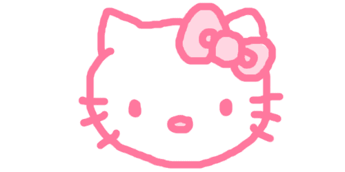
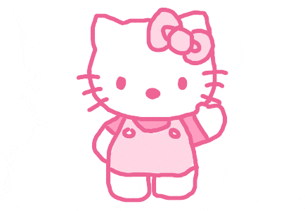

# 🌸 Hi there, I'm LEA! ✨

 

<!-- 🎀 COLLAPSIBLE LABORATORY SUBMISSIONS TOGGLE 🎀 -->

<b>💻 Laboratory Submissions & C++ Headers (click to toggle)</b>

 

> Portfolio repository for **CPE 010: DATA STRUCTURE AND ALGORITHMS**. It collects my laboratory implementations, custom headers, and analysis written in standard C++. Files are organized by term (*Prelim, Midterm, Finals*) and each activity folder also holds its lab report.

 

<!-- 🎀 ABOUT ME SECTION 🎀 -->

## 🌸 💖 ABOUT ME

I LOVE PINK HEHE

 

<!-- 🎀 LABORATORY FOLDERS 🎀 -->

## 🧸 Laboratory Folders

<table border="0" style="border-collapse: collapse; border: none;">
  <tr style="border: none;">
    <td align="center" valign="middle" style="border: none;">
      
    </td>
    <td width="30" style="border: none;"></td>
    <td align="left" valign="middle" style="border: none;">
        
        
      
    </td>
  </tr>
</table>

